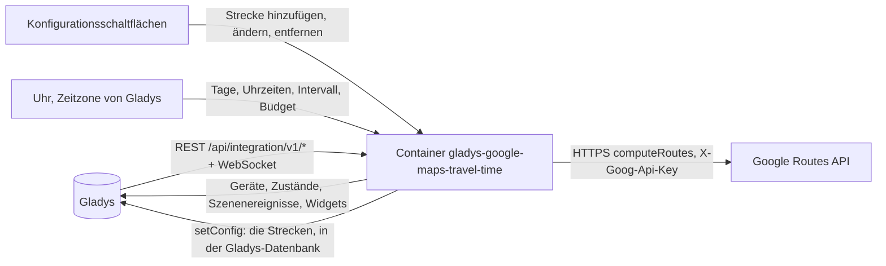
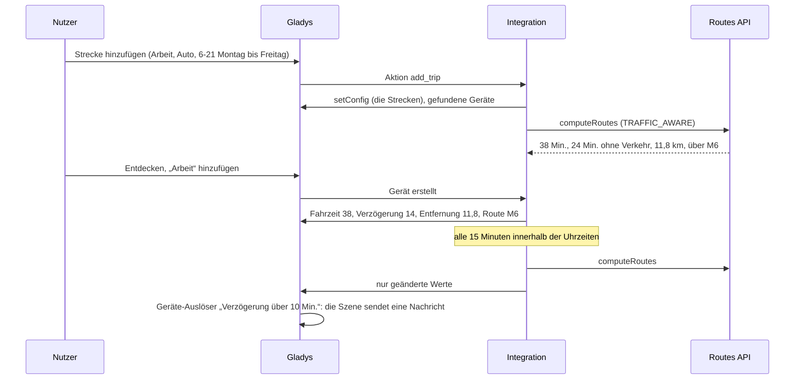
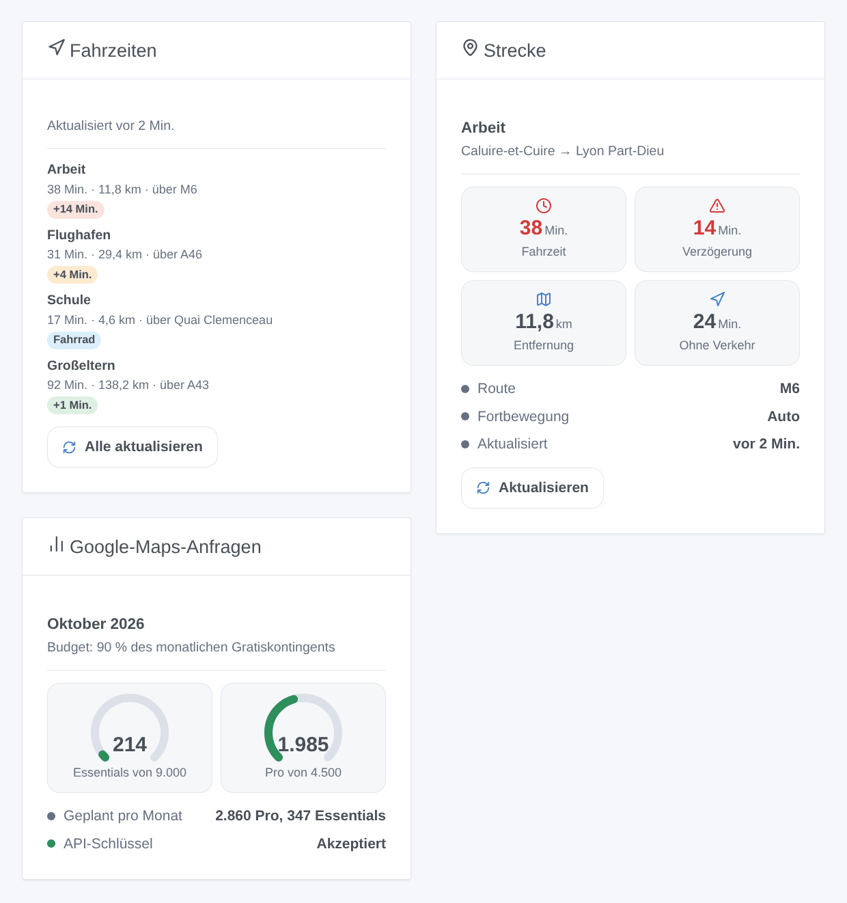

# Gladys Google Maps Travel Time

[English](README.md) · [Français](README.fr.md) · **Deutsch** · [Español](README.es.md)

[](LICENSE)
[](https://github.com/William-De71/gladys-google-maps-travel-time/releases)
[](https://github.com/William-De71/gladys-google-maps-travel-time/actions/workflows/release.yml)
[](https://gladysassistant.com)


Externe Integration für [Gladys Assistant](https://gladysassistant.com), die Ihre üblichen Strecken mit der Fahrzeit von Google Maps verfolgt: Echtzeitverkehr, Verkehrsverzögerung, Entfernung und Hauptstraßen, Szenen bei einer Routenänderung und Dashboard-Widgets. Sie nutzt die offizielle Routes API der Google Maps Platform mit Ihrem eigenen API-Schlüssel und bleibt standardmäßig im kostenlosen Monatskontingent.

Benutzerdokumentation: [English](docs/en.md) · [Français](docs/fr.md) · [Deutsch](docs/de.md) · [Español](docs/es.md).

Nicht mit Google verbunden. **Noch nicht mit einem echten Google-Maps-Platform-Schlüssel getestet**: Die Anfragen folgen der Dokumentation der Routes API, geprüft an ihren echten Fehlerantworten.

## Funktionen

- Strecken in **einfachen Formularen** der Konfiguration (kein JSON): Start und Ziel (Adresse, Ort, Plus Code oder Koordinaten), Auto, Motorrad / Roller, Fahrrad, zu Fuß oder öffentliche Verkehrsmittel, Maut, Autobahnen und Fähren vermeiden.
- **Ein Gerät pro Strecke**: Fahrzeit (mit Echtzeitverkehr per Auto und Zweirad), Zeit ohne Verkehr, Verkehrsverzögerung, Entfernung, Hauptstraßen.
- Gemessen nur **an den gewählten Tagen und Uhrzeiten** („6-10, 16-20“, Montag bis Freitag …), alle 5 bis 240 Minuten.
- Ein **Monatsbudget pro Anfrageart**: standardmäßig 90 % des Gratiskontingents von Google; die Intervalle werden gestreckt, statt es zu überschreiten.
- **3 Szenen-Auslöser**, **2 Szenen-Aktionen** und **3 Dashboard-Widgets** (unten), mit einem Link zur Route in Google Maps.
- Vier Sprachen überall: Englisch, Französisch, Deutsch, Spanisch.

## Funktionsweise




Von einer neuen Strecke zu einer Szene:



### Transport

`transports: ["cloud"]`: Die Strecken werden von Google berechnet. **Die Adressen Ihrer Strecken werden bei jeder Messung mit Ihrem API-Schlüssel an Google gesendet**; sonst verlässt nichts Ihr Gladys. Die Strecken selbst liegen in der Gladys-Konfiguration (und folgen deren Sicherungen); `/data` behält die letzten Messungen und den Anfragezähler.

## Geräte und Funktionen

| Gerät             | Funktionen (Kategorie / Typ)                                                                                                                                                    |
| ----------------- | ------------------------------------------------------------------------------------------------------------------------------------------------------------------------------- |
| Eines pro Strecke | Fahrzeit (`duration` / `integer`, Minuten), Zeit ohne Verkehr und Verkehrsverzögerung (Auto und Zweirad), Entfernung (`distance-sensor` / `decimal`, km), Hauptstraßen (`text`) |

Die externen IDs beruhen auf einer zufälligen Kennung, die jede Strecke beim Hinzufügen erhält und für immer behält, nie auf ihrem Namen oder ihren Adressen: Eine umbenannte Strecke oder ein geändertes Ziel behält Gerät und Verlauf. Ein Wechsel zwischen Auto / Zweirad und den anderen Arten fügt die Verkehrsfunktionen hinzu oder entfernt sie („Aktualisieren“ im Tab Entdecken).

## Szenen-Auslöser, Aktionen und Widgets



**Widgets**: Fahrzeiten (die Strecken mit Zeit, Entfernung, Straßen, einem Verzögerungsabzeichen — grün, orange ab 3 Minuten, rot ab der Verzögerungsschwelle — einem Google-Maps-Link und der Schaltfläche „Alle aktualisieren“), Strecke (eine Strecke: vier Kacheln, Route, letzte Messung, „Aktualisieren“), Google-Maps-Anfragen (eine Anzeige pro Anfrageart, der Plan des Monats, der Zustand des Schlüssels). Eine Aktualisieren-Schaltfläche kostet eine Anfrage pro Strecke, keine für eine vor weniger als einer Minute gemessene Strecke.

**Auslöser** (ein Ereignis pro Übergang, nie als Folge einer Aktion):

- Die Route einer Strecke ändert sich: Bei einer geplanten Messung führt die schnellste Route über andere Straßen (Sperrung, Unfall). Filter: die Strecke. Variablen: Name, Route, vorherige Route, Fahrzeit, Verzögerung, Entfernung, Zusammenfassung.
- Das Monatsbudget ist fast verbraucht: Eine Anfrageart erreicht 80 %, dann 100 %, je einmal pro Monat. Filter: Stufe, Anfrageart.
- Google lehnt den API-Schlüssel ab: einmal, bis eine Anfrage wieder funktioniert. Variablen: Grund, Zusammenfassung (mit der Abhilfe).

Verzögerung, Fahrzeit und Entfernung sind Gerätefunktionen: „die Verzögerung übersteigt 10 Minuten“ ist ein Geräte-Auslöser von Gladys.

**Aktionen**: eine Route zwischen zwei beliebigen Orten jetzt berechnen (Fahrzeit, Zeit ohne Verkehr, Verzögerung, Entfernung, Route, Zusammenfassung); eine Strecke jetzt messen, auch außerhalb ihrer Uhrzeiten (gleiche Ausgaben, das Gerät wird aktualisiert).

Beispiele:

- Wenn die Verzögerung von „Arbeit“ an einem Werktagmorgen 10 Minuten übersteigt → die Zusammenfassung senden und den Wecker 15 Minuten vorstellen.
- Wenn sich die Route von „Arbeit“ ändert → „Umleitung: {{triggerEvent.data.summary}}“ melden.
- Um 17:30 → die Strecke „Zuhause“ jetzt messen → bei über 40 Minuten Fahrzeit die Heizung früher einschalten.

## Voraussetzungen

- Gladys Assistant **5.3.0** oder neuer (Widgets und Szenen von Integrationen, Katalog-Schlagwörter von Gladys 5.3): Ältere Instanzen können die Integration nicht installieren.
- Ein **Google-Maps-Platform-API-Schlüssel**: ein Google-Cloud-Projekt mit Rechnungskonto (Google verlangt es auch im Gratiskontingent) und aktivierter **Routes API**.
- Die Zeitzone von Gladys richtig eingestellt (Einstellungen > System): Die Uhrzeiten der Strecken werden darin gelesen.

### Kosten

Google berechnet jede erfolgreiche Anfrage über ein kostenloses Monatskontingent pro Anfrageart hinaus (Preise geprüft am 2026-10-19):

| Anfrageart | Strecken                    | Gratis pro Monat | Danach, pro 1.000 |
| ---------- | --------------------------- | ---------------- | ----------------- |
| Essentials | Fahrrad, zu Fuß, ÖPNV       | 10.000           | 5 USD             |
| Pro        | Auto (Echtzeitverkehr)      | 5.000            | 10 USD            |
| Enterprise | Motorrad / Roller (Zweirad) | 1.000            | 15 USD            |

Eine Autostrecke, die von 6 bis 21 Uhr, Montag bis Freitag, alle 15 Minuten gemessen wird, plant etwa 1.300 Anfragen im Monat: Drei davon passen ins Standardbudget (90 % von 5.000). Darüber hinaus werden die Intervalle der Strecken dieser Art gestreckt. Das Gratiskontingent gilt pro Rechnungskonto: Andere Nutzungen des Kontos zählen mit.

## Installation

- **Aus dem Store**: Integrationen → Google Maps Travel Time → Installieren.
- **Über die Repository-URL**: Integrationen → externe Integration → `https://github.com/William-De71/gladys-google-maps-travel-time`.
- **Entwicklermodus**: `npm start` mit den von Gladys gelieferten Variablen starten (siehe Entwicklung).

## Konfiguration

| Feld oder Schaltfläche                    | Standard    | Bedeutung                                                                               |
| ----------------------------------------- | ----------- | --------------------------------------------------------------------------------------- |
| Google-Maps-Platform-API-Schlüssel        | —           | Erforderlich, geheim; auf die Routes API beschränken                                    |
| Standardintervall                         | 15 Min.     | 5 bis 240; für Strecken ohne eigenes Intervall                                          |
| Standard-Verzögerungsschwelle             | 10 Min.     | Rotes Abzeichen in den Widgets ab dieser Verzögerung                                    |
| Monatsbudget                              | 90 %        | Anteil des Gratiskontingents jeder Anfrageart; über 100 berechnet Google                |
| Sprache der Texte                         | automatisch | Funktionsnamen, Routenbeschreibungen, Szenen-Zusammenfassungen, Meldungen               |
| Strecke hinzufügen / ändern / entfernen   | —           | Ein Formular pro Strecke: Name, Start, Ziel, Art, vermeiden, Tage, Uhrzeiten, Intervall |
| Strecken auflisten / API-Schlüssel testen | —           | Zeitplan, Plan und letzte Messung jeder Strecke; ein kurzer Fußweg in Paris             |

## Verwendung

1. Fügen Sie Ihren API-Schlüssel ein und drücken Sie **API-Schlüssel testen** (Integrationen → Google Maps Travel Time → Konfiguration).
2. **Fügen Sie eine Strecke** für jede übliche Strecke hinzu; ihre erste Messung kommt innerhalb einer Minute, wenn sie in ihren Uhrzeiten liegt.
3. **Entdecken**, dann die gewünschten Strecken als Geräte hinzufügen.
4. Die Widgets einem Dashboard hinzufügen und Szenen mit den Gerätefunktionen, Auslösern und Aktionen bauen.

## Entwicklung

```bash
npm install
npm test                       # node --test, ohne Netzwerkzugriff
npm run lint                   # ESLint
npm run format:check           # Prettier
npx github:GladysAssistant/integration-store . --skip-image-check
scripts/build-cover.sh         # cover.jpg aus docs/assets/cover.svg
docs/illustrations/render.sh   # docs/assets/widgets.<Sprache>.png
```

Lokal liest das SDK `GLADYS_HOST_API_URL`, `GLADYS_INTEGRATION_TOKEN` und `GLADYS_INTEGRATION_SELECTOR` (von Gladys im Entwicklermodus geliefert), die Integration liest `TZ`. `DEBUG=gladys-integration-sdk` zeigt die Logs des SDK.

Die Tests decken den Client der Routes API ab (Header, Feldmaske, Wegpunkte, Verkehr, Optionen, Fehler, Abrechnungszähler), den Zeitplan (Uhrzeiten, Tage, Mitternacht, Monatsplan, Streckung), die Formulare und das Register, die Geräte (die von Entdecken verlangten Felder), die Widgets (`validateWidgetContent`), die Szenenereignisse und Ausgaben, die Uhr (Intervall, Neustart, abgelehnter Schlüssel, 429, Budget), das Manifest, die vier Sprachen, das Release-Skript und die ganze Integration gegen das Fake-Gladys des SDK und ein Fake-fetch. `test/structure.test.js` friert alle von Nutzern gespeicherten Schlüssel ein.

## Release-Prozess


Jeder Merge auf `main` startet die CI und berechnet dann die Version aus den [Conventional Commits](https://www.conventionalcommits.org/) seit dem letzten Tag: `feat` → Minor, `fix` / `perf` → Patch, `!` oder `BREAKING CHANGE` → Major (ein Minor unter 1.0.0); `docs`, `chore`, `ci`, `test`, `style`, `refactor`, `build` allein veröffentlichen nichts. Der Changelog-Abschnitt wird erzeugt, der Tag gepusht, das Multi-Architektur-Image gebaut, dann erhält `main` den Release-Commit, die GitHub Release wird erstellt und ein letzter Job prüft das öffentliche Image, den Store-Validator und das Topic.

- Der Titel des Pull Requests wird zum Squash-Commit und dann zur Changelog-Zeile: auf Englisch, für den Nutzer (`pr-title.yml` prüft ihn). `CHANGELOG.md` nie von Hand bearbeiten.
- 1.0.0 ist eine Entscheidung: Actions → Release → Run workflow mit `release-as: 1.0.0`. `dry-run` zeigt Version und Notizen ohne Veröffentlichung.
- **Geschützter Branch**: Die Release pusht ihren Commit mit `GITHUB_TOKEN` auf `main`. Das Ruleset `protect-main` (kein Löschen, kein Force-Push) lässt ihn durch; eine strengere Regel (Pull Request Pflicht, Status Checks) bräuchte GitHub Actions in der Bypass-Liste oder eine GitHub App.
- Nach der ersten Release das Paket `ghcr.io` öffentlich machen (Package settings → Change visibility), sonst kann Gladys es nicht laden.

## Fehlerbehebung

Siehe [docs/de.md](docs/de.md#fehlerbehebung). Melden Sie Probleme mit den Versionen von Gladys und der Integration, dem Ergebnis von „Strecken auflisten“ (Adressen gern unkenntlich machen) und den Logs der Integration. Fügen Sie nie Ihren API-Schlüssel ein.

## Mitwirken

Issues und Pull Requests sind willkommen. Führen Sie `npm run format:check && npm run lint && npm test` vor einem Pull Request aus und lassen Sie jede externe ID und jeden gespeicherten Schlüssel unverändert (siehe [CLAUDE.md](CLAUDE.md)).

## Sicherheit

Siehe [SECURITY.md](SECURITY.md): Schwachstellen bitte privat melden. Der API-Schlüssel ist ein `secret`-Feld: nie protokolliert, nie in `/data` geschrieben, nur in einem Header an `routes.googleapis.com` gesendet.

## Screenshots folgen

Die Bilder oben sind Illustrationen, keine Screenshots. Echte Screenshots kommen nach `docs/assets/screenshots/` (PNG, 1280 × 800): `configuration.png` (das Formular „Strecke hinzufügen“), `discovery.png`, `device.png`, `scene.png`.

## Lizenz

[Apache-Lizenz 2.0](LICENSE) — siehe auch [NOTICE](NOTICE). Google Maps ist eine Marke von Google LLC. Dank an die Dokumentation und das SDK von Gladys, an die Home-Assistant-Integration Google Maps Travel Time für ihre Bedienung und an [TomTom Travel Time](https://github.com/LM1LC3N7/gladys-tomtom-travel-time) von LM1LC3N7, die Alternative mit einem kostenlosen TomTom-Schlüssel.
