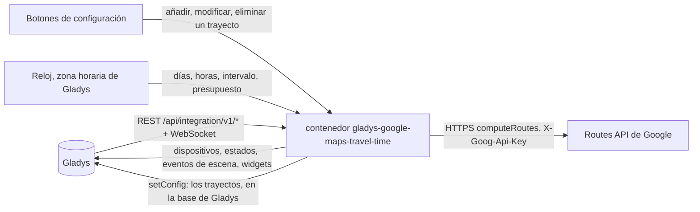
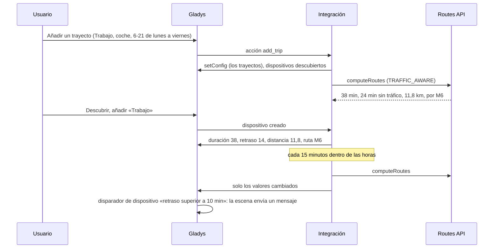
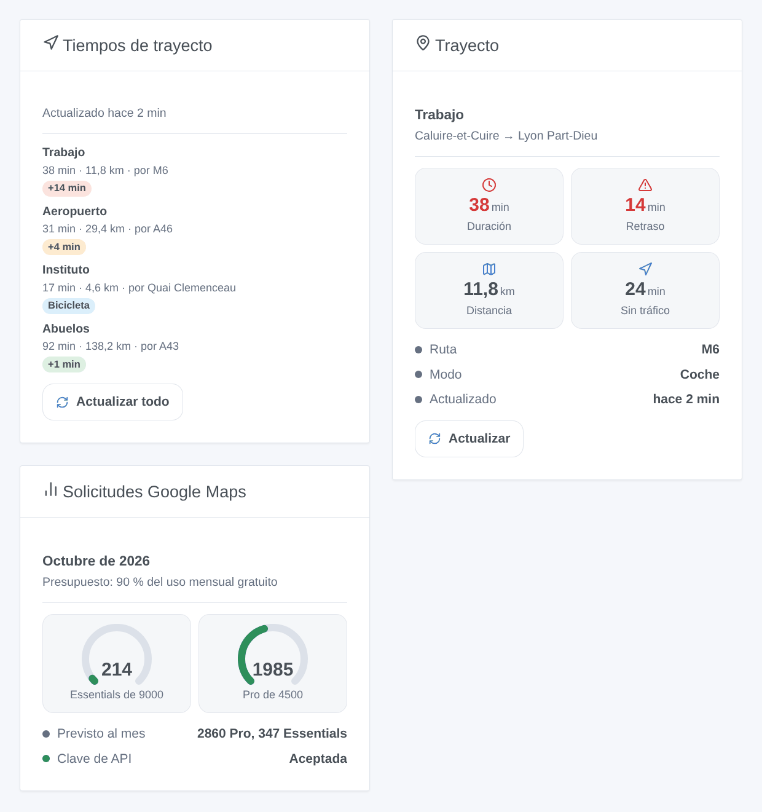

# Gladys Google Maps Travel Time

[English](README.md) · [Français](README.fr.md) · [Deutsch](README.de.md) · **Español**

[](LICENSE)
[](https://github.com/William-De71/gladys-google-maps-travel-time/releases)
[](https://github.com/William-De71/gladys-google-maps-travel-time/actions/workflows/release.yml)
[](https://gladysassistant.com)


Integración externa de [Gladys Assistant](https://gladysassistant.com) que sigue sus trayectos habituales con la duración de Google Maps: tráfico en tiempo real, retraso por tráfico, distancia y vías principales, escenas cuando cambia la ruta y widgets de panel. Usa la Routes API oficial de Google Maps Platform con su propia clave de API y, por defecto, se queda dentro del uso mensual gratuito.

Documentación de usuario: [English](docs/en.md) · [Français](docs/fr.md) · [Deutsch](docs/de.md) · [Español](docs/es.md).

Sin relación con Google. **Todavía no probada con una clave real de Google Maps Platform**: las solicitudes siguen la documentación de la Routes API, comprobada con sus respuestas de error reales.

## Funciones

- Trayectos escritos en **formularios sencillos** de la configuración (sin JSON): origen y destino (dirección, lugar, plus code o coordenadas), coche, moto / scooter, bicicleta, a pie o transporte público, evitar peajes, autopistas y ferris.
- **Un dispositivo por trayecto**: duración (con tráfico en tiempo real en coche y moto), duración sin tráfico, retraso por tráfico, distancia, vías principales.
- Medido solo **los días y a las horas que elija** («6-10, 16-20», de lunes a viernes…), cada 5 a 240 minutos.
- Un **presupuesto mensual por tipo de solicitud**: el 90 % del uso gratuito de Google por defecto; los intervalos se alargan antes que superarlo.
- **3 disparadores de escena**, **2 acciones de escena** y **3 widgets** (abajo), con un enlace a la ruta en Google Maps.
- Cuatro idiomas en todas partes: inglés, francés, alemán, español.

## Funcionamiento




De un trayecto nuevo a una escena:



### Transporte

`transports: ["cloud"]`: los trayectos los calcula Google. **Las direcciones de sus trayectos se envían a Google** con su clave de API en cada medida; nada más sale de su Gladys. Los trayectos se guardan en la configuración de Gladys (y siguen sus copias de seguridad); `/data` guarda las últimas medidas y el contador de solicitudes.

## Dispositivos y funciones

| Dispositivo      | Funciones (categoría / tipo)                                                                                                                                                    |
| ---------------- | ------------------------------------------------------------------------------------------------------------------------------------------------------------------------------- |
| Uno por trayecto | Duración (`duration` / `integer`, minutos), duración sin tráfico y retraso por tráfico (coche y moto), distancia (`distance-sensor` / `decimal`, km), vías principales (`text`) |

Los identificadores externos se basan en un identificador aleatorio que recibe cada trayecto al añadirlo y que conserva para siempre, nunca en su nombre ni en sus direcciones: renombrar un trayecto o cambiar su destino conserva su dispositivo y su historial. Pasar de coche / moto a los otros modos añade o quita las funciones de tráfico («Actualizar» en la pestaña Descubrir).

## Disparadores, acciones de escena y widgets



**Widgets**: Tiempos de trayecto (los trayectos con duración, distancia, vías, una insignia de retraso — verde, naranja desde 3 minutos, roja desde el umbral de retraso — un enlace a Google Maps y un botón «Actualizar todo»), Trayecto (un trayecto: cuatro mosaicos, ruta, última medida, «Actualizar»), Solicitudes Google Maps (un indicador por tipo de solicitud, lo previsto del mes, el estado de la clave). Un botón de actualizar gasta una solicitud por trayecto, ninguna para un trayecto medido hace menos de un minuto.

**Disparadores** (un evento por transición, nunca como consecuencia de una acción):

- La ruta de un trayecto cambia: en una medida programada, la ruta más rápida pasa por otras vías (vía cortada, accidente). Filtro: el trayecto. Variables: nombre, ruta, ruta anterior, duración, retraso, distancia, resumen.
- El presupuesto del mes está casi gastado: un tipo de solicitud llega al 80 % y luego al 100 %, una vez cada uno al mes. Filtros: nivel, tipo de solicitud.
- Google rechaza la clave de API: una vez, hasta que una solicitud vuelva a funcionar. Variables: motivo, resumen (con qué corregir).

El retraso, la duración y la distancia son funciones del dispositivo: «el retraso supera 10 minutos» es un disparador de dispositivo de Gladys.

**Acciones**: calcular ahora una ruta entre dos lugares cualesquiera (duración, duración sin tráfico, retraso, distancia, ruta, frase de resumen); medir ahora un trayecto, también fuera de sus horas (mismas salidas, el dispositivo se actualiza).

Ejemplos:

- Cuando el retraso de «Trabajo» supera 10 minutos una mañana laborable → enviar el resumen y adelantar el despertador 15 minutos.
- Cuando cambia la ruta de «Trabajo» → avisar «Tráfico desviado: {{triggerEvent.data.summary}}».
- A las 17:30 → medir ahora el trayecto «Casa» → si la duración supera 40 minutos, encender antes la calefacción.

## Requisitos

- Gladys Assistant **5.1.0** o posterior (widgets y escenas de integraciones): las instancias anteriores no pueden instalar la integración.
- Una **clave de API de Google Maps Platform**: un proyecto de Google Cloud con una cuenta de facturación (Google la exige incluso en el uso gratuito) y la **Routes API** activada.
- La zona horaria de Gladys bien configurada (Ajustes > Sistema): las horas de los trayectos se leen en ella.

### Coste

Google factura cada solicitud correcta más allá de un uso mensual gratuito por tipo de solicitud (precios comprobados el 2026-10-19):

| Tipo de solicitud | Trayectos                      | Gratis al mes | Después, por 1000 |
| ----------------- | ------------------------------ | ------------- | ----------------- |
| Essentials        | bicicleta, a pie, transporte   | 10 000        | 5 USD             |
| Pro               | coche (tráfico en tiempo real) | 5000          | 10 USD            |
| Enterprise        | moto / scooter (dos ruedas)    | 1000          | 15 USD            |

Un trayecto en coche medido cada 15 minutos de 6 a 21 h, de lunes a viernes, prevé unas 1300 solicitudes al mes: tres caben en el presupuesto por defecto (90 % de 5000). Más allá, los intervalos de los trayectos de ese tipo se alargan. El uso gratuito es por cuenta de facturación: los demás usos de la cuenta también cuentan.

## Instalación

- **Desde la tienda**: Integraciones → Google Maps Travel Time → Instalar.
- **Desde la URL del repositorio**: Integraciones → integración externa → `https://github.com/William-De71/gladys-google-maps-travel-time`.
- **Modo desarrollador**: ejecutar `npm start` con las variables que da Gladys (ver Desarrollo).

## Configuración

| Campo o botón                             | Por defecto | Significado                                                                         |
| ----------------------------------------- | ----------- | ----------------------------------------------------------------------------------- |
| Clave de API de Google Maps Platform      | —           | Obligatoria, secreta; restrínjala a la Routes API                                   |
| Intervalo por defecto                     | 15 min      | 5 a 240; para los trayectos sin intervalo propio                                    |
| Umbral de retraso por defecto             | 10 min      | Insignia roja en los widgets a partir de este retraso                               |
| Presupuesto mensual                       | 90 %        | Parte del uso gratuito de cada tipo de solicitud; por encima de 100, Google factura |
| Idioma de los textos                      | automático  | Nombres de funciones, rutas, resúmenes de escena, mensajes de los botones           |
| Añadir / Modificar / Eliminar un trayecto | —           | Un formulario por trayecto: nombre, origen, destino, modo, evitar, días, horas      |
| Listar los trayectos / Probar la clave    | —           | Horario, previsto y última medida de cada trayecto; un paseo corto por París        |

## Uso

1. Pegue su clave de API y pulse **Probar la clave de API** (Integraciones → Google Maps Travel Time → Configuración).
2. **Añada un trayecto** para cada trayecto habitual; su primera medida llega en un minuto si está dentro de sus horas.
3. **Descubrir**, y añada como dispositivos los trayectos que quiera.
4. Añada los widgets a un panel y cree escenas con las funciones de los dispositivos, los disparadores y las acciones.

## Desarrollo

```bash
npm install
npm test                       # node --test, sin tocar nunca la red
npm run lint                   # ESLint
npm run format:check           # Prettier
npx github:GladysAssistant/integration-store . --skip-image-check
scripts/build-cover.sh         # cover.jpg desde docs/assets/cover.svg
docs/illustrations/render.sh   # docs/assets/widgets.<idioma>.png
```

En local, el SDK lee `GLADYS_HOST_API_URL`, `GLADYS_INTEGRATION_TOKEN` y `GLADYS_INTEGRATION_SELECTOR` (que da Gladys en modo desarrollador), y la integración lee `TZ`. `DEBUG=gladys-integration-sdk` muestra los registros del SDK.

Las pruebas cubren el cliente de la Routes API (cabeceras, máscara de campos, puntos de paso, tráfico, opciones, errores, recuento facturado), el horario (horas, días, medianoche, previsto del mes, alargamiento), los formularios y el registro, los dispositivos (los campos que exige Descubrir), los widgets (`validateWidgetContent`), los eventos y salidas de escena, el reloj (intervalo, reinicio, clave rechazada, 429, presupuesto), el manifiesto, los cuatro idiomas, el script de release y toda la integración frente al Gladys falso del SDK y un fetch falso. `test/structure.test.js` congela todas las claves que guardan los usuarios.

## Proceso de release


Cada fusión en `main` lanza la CI y calcula la versión a partir de los [Conventional Commits](https://www.conventionalcommits.org/) desde la última etiqueta: `feat` → menor, `fix` / `perf` → parche, `!` o `BREAKING CHANGE` → mayor (una menor por debajo de 1.0.0); `docs`, `chore`, `ci`, `test`, `style`, `refactor`, `build` solos no publican nada. Se genera la sección del changelog, se sube la etiqueta, se construye la imagen multiarquitectura, luego `main` recibe el commit de release, se crea la GitHub Release y un último job comprueba la imagen pública, el validador de la tienda y el topic.

- El título de la pull request se convierte en el commit de squash y luego en la línea del changelog: escríbalo en inglés, para el usuario (`pr-title.yml` lo comprueba). No edite nunca `CHANGELOG.md` a mano.
- La 1.0.0 es una decisión: Actions → Release → Run workflow con `release-as: 1.0.0`. `dry-run` muestra la versión y las notas sin publicar.
- **Rama protegida**: la release sube su commit a `main` con `GITHUB_TOKEN`. El ruleset `protect-main` (sin borrado ni force-push) lo deja pasar; una regla más estricta (pull request obligatoria, status checks) necesitaría GitHub Actions en su lista de excepciones, o una GitHub App.
- Tras la primera release, haga público el paquete `ghcr.io` (Package settings → Change visibility), o Gladys no podrá descargarlo.

## Solución de problemas

Vea [docs/es.md](docs/es.md#solución-de-problemas). Informe de los problemas con las versiones de Gladys y de la integración, el resultado de «Listar los trayectos» (oculte sus direcciones si quiere) y los registros de la integración. No pegue nunca su clave de API.

## Contribuir

Las issues y pull requests son bienvenidas. Ejecute `npm run format:check && npm run lint && npm test` antes de abrir una pull request, y no cambie ningún identificador externo ni ninguna clave guardada (ver [CLAUDE.md](CLAUDE.md)).

## Seguridad

Vea [SECURITY.md](SECURITY.md): informe de las vulnerabilidades en privado. La clave de API es un campo `secret`: nunca registrada, nunca escrita en `/data`, enviada solo a `routes.googleapis.com` en una cabecera.

## Capturas pendientes

Las imágenes de arriba son ilustraciones, no capturas de pantalla. Las capturas reales irán en `docs/assets/screenshots/` (PNG, 1280 × 800): `configuration.png` (el formulario «Añadir un trayecto»), `discovery.png`, `device.png`, `scene.png`.

## Licencia

[Licencia Apache 2.0](LICENSE) — vea también [NOTICE](NOTICE). Google Maps es una marca de Google LLC. Gracias a la documentación y al SDK de Gladys, a la integración Google Maps Travel Time de Home Assistant por su ergonomía, y a [TomTom Travel Time](https://github.com/LM1LC3N7/gladys-tomtom-travel-time) de LM1LC3N7, la alternativa con una clave TomTom gratuita.
