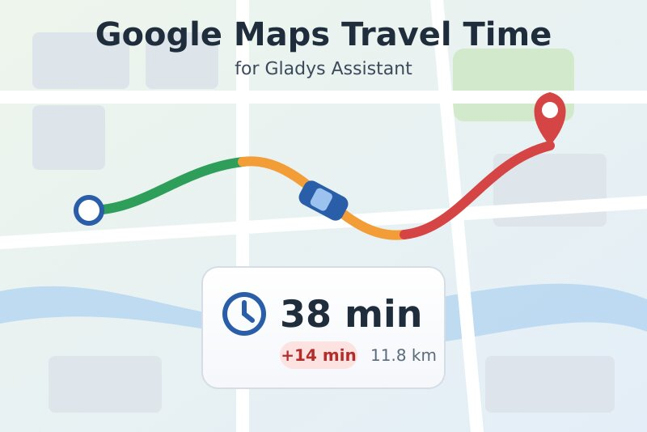
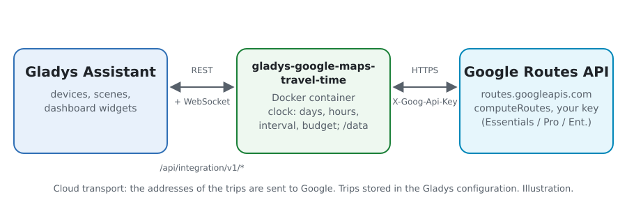
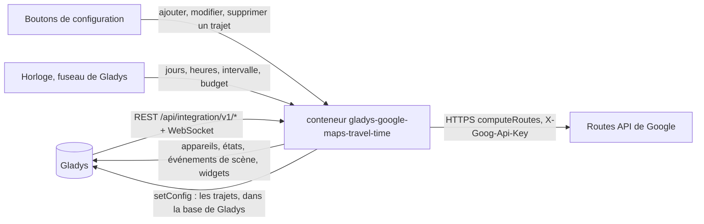
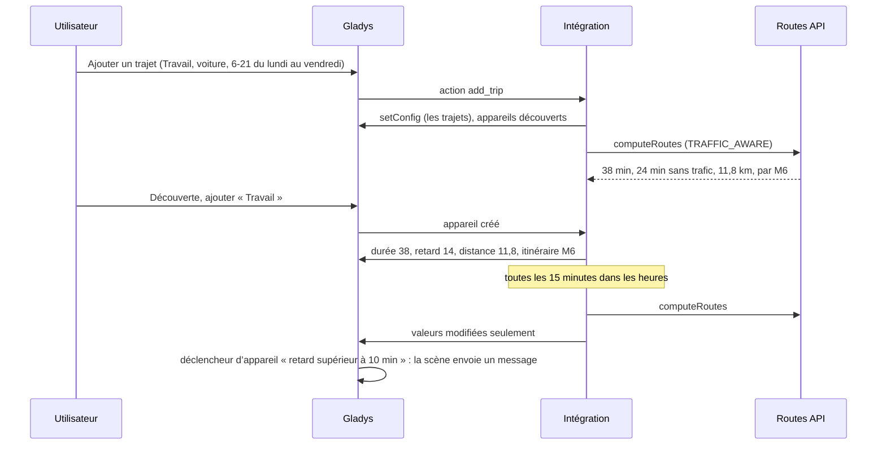
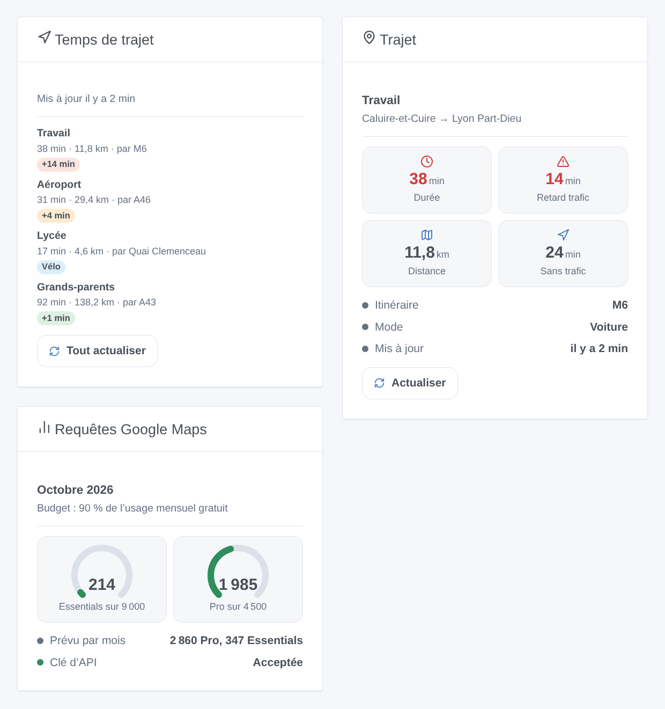

# Gladys Google Maps Travel Time

[English](README.md) · **Français** · [Deutsch](README.de.md) · [Español](README.es.md)

[](LICENSE)
[](https://github.com/William-De71/gladys-google-maps-travel-time/releases)
[](https://github.com/William-De71/gladys-google-maps-travel-time/actions/workflows/release.yml)
[](https://gladysassistant.com)



Intégration externe de [Gladys Assistant](https://gladysassistant.com) qui suit vos trajets habituels avec la durée de Google Maps : trafic en temps réel, retard dû au trafic, distance et routes principales, scènes quand l’itinéraire change, et widgets de tableau de bord. Elle passe par la Routes API officielle de Google Maps Platform avec votre propre clé d’API, et reste par défaut dans l’usage mensuel gratuit.

Documentation utilisateur : [English](docs/en.md) · [Français](docs/fr.md) · [Deutsch](docs/de.md) · [Español](docs/es.md).

Sans lien avec Google. **Pas encore testée avec une vraie clé Google Maps Platform** : les requêtes suivent la documentation de la Routes API, vérifiée sur ses vraies réponses d’erreur.

## Fonctionnalités

- Trajets saisis dans des **formulaires simples** de la configuration (pas de JSON) : départ et arrivée (adresse, lieu, plus code ou coordonnées), voiture, moto / scooter, vélo, à pied ou transports en commun, éviter péages, autoroutes et ferries.
- **Un appareil par trajet** : durée (avec trafic en temps réel en voiture et deux-roues), durée sans trafic, retard dû au trafic, distance, routes principales.
- Mesuré seulement **les jours et aux heures choisis** (« 6-10, 16-20 », du lundi au vendredi…), toutes les 5 à 240 minutes.
- Un **budget mensuel par type de requête** : 90 % de l’usage gratuit de Google par défaut ; les intervalles s’allongent plutôt que de le dépasser.
- **3 déclencheurs de scène**, **2 actions de scène** et **3 widgets** (ci-dessous), avec un lien vers l’itinéraire dans Google Maps.
- Quatre langues partout : anglais, français, allemand, espagnol.

## Fonctionnement





D’un nouveau trajet à une scène :



### Transport

`transports: ["cloud"]` : les trajets sont calculés par Google. **Les adresses de vos trajets sont envoyées à Google** avec votre clé d’API, à chaque mesure ; rien d’autre ne quitte votre Gladys. Les trajets eux-mêmes sont enregistrés dans la configuration de Gladys (et suivent ses sauvegardes) ; `/data` garde les dernières mesures et le compteur de requêtes.

## Appareils et fonctionnalités

| Appareil      | Fonctionnalités (catégorie / type)                                                                                                                                                   |
| ------------- | ------------------------------------------------------------------------------------------------------------------------------------------------------------------------------------ |
| Un par trajet | Durée (`duration` / `integer`, minutes), durée sans trafic et retard dû au trafic (voiture et deux-roues), distance (`distance-sensor` / `decimal`, km), routes principales (`text`) |

Les identifiants externes reposent sur un identifiant aléatoire donné à chaque trajet à son ajout et gardé pour toujours, jamais sur son nom ni ses adresses : renommer un trajet ou changer sa destination garde son appareil et son historique. Passer de voiture / deux-roues aux autres modes ajoute ou retire les fonctionnalités de trafic (« Mettre à jour » dans l’onglet Découverte).

## Déclencheurs, actions de scène et widgets



**Widgets** : Temps de trajet (les trajets avec durée, distance, routes, un badge de retard — vert, orange dès 3 minutes, rouge dès le seuil de retard — un lien Google Maps et un bouton « Tout actualiser »), Trajet (un trajet : quatre tuiles, itinéraire, dernière mesure, « Actualiser »), Requêtes Google Maps (une jauge par type de requête, le prévu du mois, l’état de la clé). Un bouton d’actualisation dépense une requête par trajet, aucune pour un trajet mesuré il y a moins d’une minute.

**Déclencheurs** (un événement par transition, jamais à la suite d’une action) :

- L’itinéraire d’un trajet change : lors d’une mesure planifiée, l’itinéraire le plus rapide passe par d’autres routes (route fermée, accident). Filtre : le trajet. Variables : nom, itinéraire, itinéraire précédent, durée, retard, distance, résumé.
- Le budget du mois est presque utilisé : un type de requête atteint 80 %, puis 100 %, une fois chacun par mois. Filtres : niveau, type de requête.
- Google refuse la clé d’API : une fois, jusqu’à ce qu’une requête fonctionne de nouveau. Variables : raison, résumé (avec quoi corriger).

Le retard, la durée et la distance sont des fonctionnalités d’appareil : « le retard dépasse 10 minutes » est un déclencheur d’appareil de Gladys.

**Actions** : calculer un itinéraire entre deux lieux quelconques maintenant (durée, durée sans trafic, retard, distance, itinéraire, phrase de résumé) ; mesurer un trajet maintenant, même hors de ses heures (mêmes sorties, l’appareil est mis à jour).

Exemples :

- Quand le retard de « Travail » dépasse 10 minutes un matin de semaine → envoyer le résumé et avancer le réveil de 15 minutes.
- Quand l’itinéraire de « Travail » change → notifier « Trafic dévié : {{triggerEvent.data.summary}} ».
- À 17 h 30 → mesurer le trajet « Maison » maintenant → si la durée dépasse 40 minutes, lancer le chauffage plus tôt.

## Prérequis

- Gladys Assistant **5.3.0** ou plus récent (widgets et scènes des intégrations, mots-clés du catalogue de Gladys 5.3) : les instances plus anciennes ne peuvent pas installer l’intégration.
- Une **clé d’API Google Maps Platform** : un projet Google Cloud avec un compte de facturation (Google l’exige même dans l’usage gratuit) et la **Routes API** activée.
- Le fuseau horaire de Gladys bien réglé (Paramètres > Système) : les heures des trajets y sont lues.

### Coût

Google facture chaque requête réussie au-delà d’un usage mensuel gratuit par type de requête (tarifs vérifiés le 2026-10-19) :

| Type de requête | Trajets                            | Gratuit par mois | Ensuite, pour 1 000 |
| --------------- | ---------------------------------- | ---------------- | ------------------- |
| Essentials      | vélo, à pied, transports en commun | 10 000           | 5 USD               |
| Pro             | voiture (trafic en temps réel)     | 5 000            | 10 USD              |
| Enterprise      | moto / scooter (deux-roues)        | 1 000            | 15 USD              |

Un trajet en voiture mesuré toutes les 15 minutes de 6 h à 21 h, du lundi au vendredi, prévoit environ 1 300 requêtes par mois : trois tiennent dans le budget par défaut (90 % de 5 000). Au-delà, les intervalles des trajets de ce type s’allongent. L’usage gratuit est par compte de facturation : les autres usages du compte comptent aussi.

## Installation

- **Depuis le store** : Intégrations → Google Maps Travel Time → Installer.
- **Depuis l’URL du dépôt** : Intégrations → intégration externe → `https://github.com/William-De71/gladys-google-maps-travel-time`.
- **Mode développeur** : lancer `npm start` avec les variables données par Gladys (voir Développement).

## Configuration

| Champ ou bouton                          | Par défaut  | Rôle                                                                                     |
| ---------------------------------------- | ----------- | ---------------------------------------------------------------------------------------- |
| Clé d’API Google Maps Platform           | —           | Obligatoire, secrète ; limitez-la à la Routes API                                        |
| Intervalle par défaut                    | 15 min      | 5 à 240 ; pour les trajets sans intervalle propre                                        |
| Seuil de retard par défaut               | 10 min      | Badge rouge dans les widgets à partir de ce retard                                       |
| Budget mensuel                           | 90 %        | Part de l’usage gratuit de chaque type de requête ; au-delà de 100, Google facture       |
| Langue des textes                        | automatique | Noms des fonctionnalités, itinéraires, résumés de scène, messages des boutons            |
| Ajouter / Modifier / Supprimer un trajet | —           | Un formulaire par trajet : nom, départ, arrivée, mode, éviter, jours, heures, intervalle |
| Lister les trajets / Tester la clé d’API | —           | Planning, prévu et dernière mesure de chaque trajet ; une courte marche dans Paris       |

## Utilisation

1. Collez votre clé d’API, puis appuyez sur **Tester la clé d’API** (Intégrations → Google Maps Travel Time → Configuration).
2. **Ajoutez un trajet** pour chaque trajet habituel ; sa première mesure arrive dans la minute s’il est dans ses heures.
3. **Découverte**, puis ajoutez les trajets voulus comme appareils.
4. Ajoutez les widgets à un tableau de bord, et créez des scènes avec les fonctionnalités des appareils, les déclencheurs et les actions.

## Développement

```bash
npm install
npm test                       # node --test, sans jamais toucher au réseau
npm run lint                   # ESLint
npm run format:check           # Prettier
npx github:GladysAssistant/integration-store . --skip-image-check
scripts/build-cover.sh         # cover.jpg depuis docs/assets/cover.svg
docs/illustrations/render.sh   # docs/assets/widgets.<langue>.png
```

En local, le SDK lit `GLADYS_HOST_API_URL`, `GLADYS_INTEGRATION_TOKEN` et `GLADYS_INTEGRATION_SELECTOR` (donnés par Gladys en mode développeur), et l’intégration lit `TZ`. `DEBUG=gladys-integration-sdk` affiche les journaux du SDK.

Les tests couvrent le client de la Routes API (en-têtes, masque de champs, points de passage, trafic, options, erreurs, comptage facturé), le planning (heures, jours, minuit, prévu du mois, allongement), les formulaires et le registre, les appareils (les champs qu’exige l’écran Découverte), les widgets (`validateWidgetContent`), les événements et sorties de scène, l’horloge (intervalle, redémarrage, clé refusée, 429, budget), le manifeste, les quatre langues, le script de release, et toute l’intégration face au faux Gladys du SDK et à un faux fetch. `test/structure.test.js` fige toutes les clés enregistrées par les utilisateurs.

## Processus de release


Chaque fusion sur `main` lance la CI, puis calcule la version d’après les [Conventional Commits](https://www.conventionalcommits.org/) depuis le dernier tag : `feat` → mineure, `fix` / `perf` → correctif, `!` ou `BREAKING CHANGE` → majeure (une mineure tant que < 1.0.0) ; `docs`, `chore`, `ci`, `test`, `style`, `refactor`, `build` seuls ne publient rien. La section du changelog est générée, le tag poussé, l’image multi-architecture construite, puis `main` reçoit le commit de release, la GitHub Release est créée et un dernier job vérifie l’image publique, le validateur du store et le topic.

- Le titre de la pull request devient le commit de squash, puis la ligne du changelog : écrivez-le en anglais, pour l’utilisateur (`pr-title.yml` le vérifie). Ne modifiez jamais `CHANGELOG.md` à la main.
- La 1.0.0 est une décision : Actions → Release → Run workflow avec `release-as: 1.0.0`. `dry-run` montre la version et les notes sans rien publier.
- **Branche protégée** : la release pousse son commit sur `main` avec `GITHUB_TOKEN`. Le ruleset `protect-main` (ni suppression, ni force-push) le laisse passer ; une règle plus stricte (pull request obligatoire, status checks) demanderait GitHub Actions dans sa liste de contournement, ou une GitHub App.
- Après la première release, rendez public le package `ghcr.io` (Package settings → Change visibility), sinon Gladys ne peut pas le télécharger.

## Dépannage

Voir [docs/fr.md](docs/fr.md#dépannage). Signalez les problèmes avec les versions de Gladys et de l’intégration, le résultat de « Lister les trajets » (masquez vos adresses si vous le souhaitez) et les journaux de l’intégration. Ne collez jamais votre clé d’API.

## Contribuer

Les issues et pull requests sont bienvenues. Lancez `npm run format:check && npm run lint && npm test` avant d’ouvrir une pull request, et ne changez aucun identifiant externe ni aucune clé enregistrée (voir [CLAUDE.md](CLAUDE.md)).

## Sécurité

Voir [SECURITY.md](SECURITY.md) : signalez les vulnérabilités en privé. La clé d’API est un champ `secret` : jamais journalisée, jamais écrite dans `/data`, envoyée seulement à `routes.googleapis.com` dans un en-tête.

## Captures à venir

Les images ci-dessus sont des illustrations, pas des captures d’écran. Les vraies captures iront dans `docs/assets/screenshots/` (PNG, 1280 × 800) : `configuration.png` (le formulaire « Ajouter un trajet »), `discovery.png`, `device.png`, `scene.png`.

## Licence

[Licence Apache 2.0](LICENSE) — voir aussi [NOTICE](NOTICE). Google Maps est une marque de Google LLC. Merci à la documentation et au SDK de Gladys, à l’intégration Google Maps Travel Time de Home Assistant pour son ergonomie, et à [TomTom Travel Time](https://github.com/LM1LC3N7/gladys-tomtom-travel-time) de LM1LC3N7, l’alternative avec une clé TomTom gratuite.
