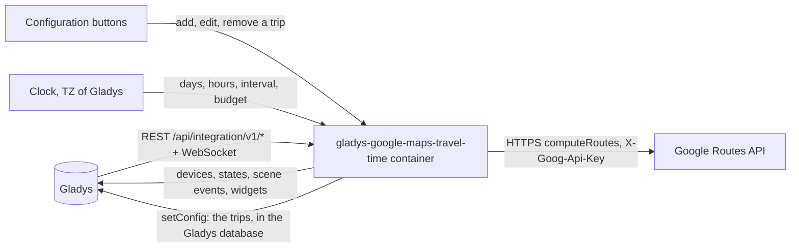
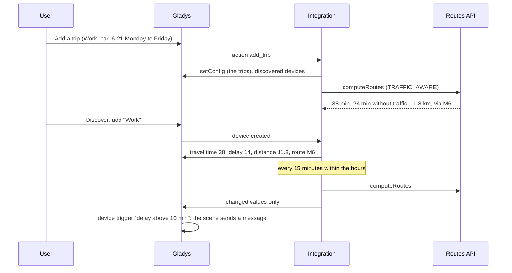
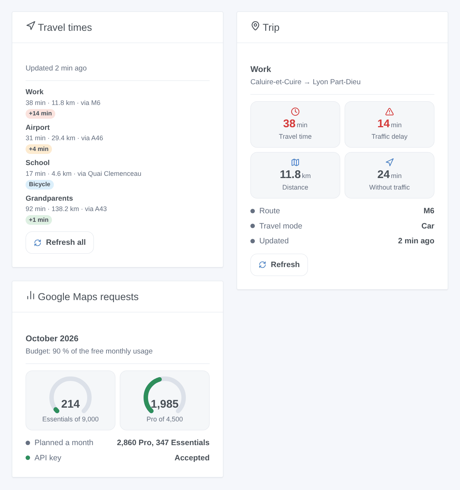

# Gladys Google Maps Travel Time

**English** · [Français](README.fr.md) · [Deutsch](README.de.md) · [Español](README.es.md)

[](LICENSE)
[](https://github.com/William-De71/gladys-google-maps-travel-time/releases)
[](https://github.com/William-De71/gladys-google-maps-travel-time/actions/workflows/release.yml)
[](https://gladysassistant.com)


[Gladys Assistant](https://gladysassistant.com) external integration that follows your usual trips with the travel time of Google Maps: live traffic, traffic delay, distance and main roads, scenes when the route changes, and dashboard widgets. It uses the official Google Maps Platform Routes API with your own API key, and keeps its requests within the free monthly usage by default.

User documentation: [English](docs/en.md) · [Français](docs/fr.md) · [Deutsch](docs/de.md) · [Español](docs/es.md).

Not affiliated with Google. **Not tested with a real Google Maps Platform key yet**: the requests follow the documentation of the Routes API, checked against its real error answers.

## Features

- Trips typed in **plain forms** of the configuration (no JSON): from and to (address, place, plus code or coordinates), car, motorcycle / scooter, bicycle, walking or public transport, avoid tolls, motorways and ferries.
- **One device per trip**: travel time (with live traffic by car and two-wheeler), time without traffic, traffic delay, distance, main roads.
- Read only **on the days and hours you choose** ("6-10, 16-20", Monday to Friday…), at an interval of 5 to 240 minutes.
- A **monthly budget per request type**: 90 % of Google's free usage by default; the intervals are stretched rather than going over.
- **3 scene triggers**, **2 scene actions** and **3 dashboard widgets** (below), with a link to the route in Google Maps.
- Four languages everywhere: English, French, German, Spanish.

## How it works




From a new trip to a scene:



### Transport

`transports: ["cloud"]`: the trips are computed by Google. **The addresses of your trips are sent to Google** with your API key, at each reading; nothing else leaves your Gladys. The trips themselves are stored in the Gladys configuration (and follow its backups); `/data` keeps the last readings and the request counter.

## Devices and features

| Device       | Features (category / type)                                                                                                                                                     |
| ------------ | ------------------------------------------------------------------------------------------------------------------------------------------------------------------------------ |
| One per trip | Travel time (`duration` / `integer`, minutes), time without traffic and traffic delay (car and two-wheeler), distance (`distance-sensor` / `decimal`, km), main roads (`text`) |

External ids rest on a random identifier given to each trip when it is added and kept for ever, never on its name nor its addresses: renaming a trip or moving its destination keeps its device and its history. Changing between car / two-wheeler and the other modes adds or removes the traffic features ("Update" on the Discover tab).

## Scene triggers, actions and widgets



**Widgets**: Travel times (the trips with time, distance, roads, a delay badge — green, orange from 3 minutes, red from the delay threshold — a Google Maps link and a "Refresh all" button), Trip (one trip: four tiles, route, last reading, "Refresh"), Google Maps requests (one gauge per request type, the plan of the month, the state of the key). A refresh button spends one request per trip, none for a trip read less than a minute ago.

**Triggers** (one event per transition, never as the result of an action):

- The route of a trip changes: at a scheduled reading, the fastest route goes by other roads (a closed road, an accident). Filter: the trip. Variables: name, route, previous route, travel time, delay, distance, summary.
- The monthly budget is almost used: a request type reaches 80 %, then 100 %, once each per month. Filters: level, request type.
- Google refuses the API key: once, until a request works again. Variables: reason, summary (with what to fix).

The delay, the travel time and the distance are device features: "the delay goes above 10 minutes" is a device trigger of Gladys.

**Actions**: compute a route between any two places now (travel time, time without traffic, delay, distance, route, summary sentence); read a trip now, outside its hours too (same outputs, the device is updated).

Examples:

- When the delay of "Work" goes above 10 minutes on a weekday morning → send the summary and set the alarm 15 minutes earlier.
- When the route of "Work" changes → notify "Traffic diverted: {{triggerEvent.data.summary}}".
- At 17:30 → read the trip "Home" now → if the travel time is above 40 minutes, turn on the heating earlier.

## Requirements

- Gladys Assistant **5.3.0** or later (widgets and scenes of integrations, catalog keywords of Gladys 5.3): older instances cannot install the integration.
- A **Google Maps Platform API key**: a Google Cloud project with a billing account (Google asks for one even within the free usage) and the **Routes API** enabled.
- The timezone of Gladys set correctly (Settings > System): the hours of the trips are read in it.

### Cost

Google bills every successful request beyond a free monthly usage per request type (pricing checked on 2026-10-19):

| Request type | Trips                            | Free a month | Then, per 1,000 |
| ------------ | -------------------------------- | ------------ | --------------- |
| Essentials   | bicycle, walking, transport      | 10,000       | 5 USD           |
| Pro          | car (live traffic)               | 5,000        | 10 USD          |
| Enterprise   | motorcycle / scooter (two-wheel) | 1,000        | 15 USD          |

A car trip read every 15 minutes from 6 to 21, Monday to Friday, plans about 1,300 requests a month: three of them fit in the default budget (90 % of 5,000). Beyond, the intervals of the trips of that type are stretched. The free usage is per billing account: other uses of the account count too.

## Installation

- **From the store**: Integrations → Google Maps Travel Time → Install.
- **From the repository URL**: Integrations → external integration → `https://github.com/William-De71/gladys-google-maps-travel-time`.
- **Developer mode**: run `npm start` with the variables given by Gladys (see Development).

## Configuration

| Field or button                   | Default   | Meaning                                                                                |
| --------------------------------- | --------- | -------------------------------------------------------------------------------------- |
| Google Maps Platform API key      | —         | Required, a secret; restrict it to the Routes API                                      |
| Default interval                  | 15 min    | 5 to 240; for the trips without their own                                              |
| Default delay threshold           | 10 min    | Red badge in the widgets from this delay                                               |
| Monthly budget                    | 90 %      | Share of the free usage of each request type; above 100, Google bills                  |
| Language of the texts             | automatic | Feature names, route descriptions, scene summaries, button messages                    |
| Add / Edit / Remove a trip        | —         | One form per trip: name, from, to, mode, avoid, days, hours, interval, threshold       |
| List the trips / Test the API key | —         | Schedule, plan and last reading of each trip; a short walk in Paris (1 Essentials req) |

## Usage

1. Paste your API key, then press **Test the API key** (Integrations → Google Maps Travel Time → Configuration).
2. **Add a trip** for each usual trip; its first reading comes within a minute when it is in its hours.
3. **Discover**, then add the trips you want as devices.
4. Add the widgets to a dashboard, and build scenes with the device features, the triggers and the actions.

## Development

```bash
npm install
npm test                       # node --test, never touches the network
npm run lint                   # ESLint
npm run format:check           # Prettier
npx github:GladysAssistant/integration-store . --skip-image-check
scripts/build-cover.sh         # cover.jpg from docs/assets/cover.svg
docs/illustrations/render.sh   # docs/assets/widgets.<lang>.png
```

Locally, the SDK reads `GLADYS_HOST_API_URL`, `GLADYS_INTEGRATION_TOKEN` and `GLADYS_INTEGRATION_SELECTOR` (given by Gladys in developer mode), and the integration reads `TZ`. `DEBUG=gladys-integration-sdk` shows the SDK logs.

The tests cover the Routes API client (headers, field mask, waypoints, traffic, modifiers, errors, billing count), the schedule (hours, days, midnight, monthly plan, stretching), the forms and the registry, the devices (the fields the Discovery screen requires), the widgets (`validateWidgetContent`), the scene events and outputs, the clock (interval, restart, refused key, 429, budget), the manifest, the four languages, the release script, and the whole integration against the fake Gladys of the SDK and a fake fetch. `test/structure.test.js` freezes every key users store.

## Release process


Every merge on `main` runs the CI, then computes the version from the [Conventional Commits](https://www.conventionalcommits.org/) since the last tag: `feat` → minor, `fix` / `perf` → patch, `!` or `BREAKING CHANGE` → major (a minor below 1.0.0); `docs`, `chore`, `ci`, `test`, `style`, `refactor`, `build` alone publish nothing. The changelog section is generated, the tag pushed, the multi-architecture image built, then `main` receives the release commit, the GitHub Release is created and a last job checks the public image, the store validator and the topic.

- The pull request title becomes the squash commit, then the changelog line: write it in English, for the user (`pr-title.yml` checks it). Never edit `CHANGELOG.md` by hand.
- 1.0.0 is a decision: Actions → Release → Run workflow with `release-as: 1.0.0`. `dry-run` shows the version and the notes without publishing.
- **Protected branch**: the release pushes its commit to `main` with `GITHUB_TOKEN`. The `protect-main` ruleset (no deletion, no force-push) lets it through; a stricter rule (pull request required, status checks) would need GitHub Actions in its bypass list, or a GitHub App.
- After the first release, make the `ghcr.io` package public (Package settings → Change visibility), or Gladys cannot pull it.

## Troubleshooting

See [docs/en.md](docs/en.md#troubleshooting). Report issues with the versions of Gladys and of the integration, the result of "List the trips" (hide your addresses if you wish) and the logs of the integration. Never paste your API key.

## Contributing

Issues and pull requests are welcome. Run `npm run format:check && npm run lint && npm test` before opening a pull request, and keep every external id and stored key unchanged (see [CLAUDE.md](CLAUDE.md)).

## Security

See [SECURITY.md](SECURITY.md): report vulnerabilities privately. The API key is a `secret` field: never logged, never written to `/data`, sent only to `routes.googleapis.com` in a header.

## Screenshots to come

The images above are illustrations, not screenshots. Real screenshots will go in `docs/assets/screenshots/` (PNG, 1280 × 800): `configuration.png` (the "Add a trip" form), `discovery.png`, `device.png`, `scene.png`.

## License

[Apache License 2.0](LICENSE) — see also [NOTICE](NOTICE). Google Maps is a trademark of Google LLC. Thanks to the Gladys documentation and SDK, to the Home Assistant Google Maps Travel Time integration for its ergonomics, and to [TomTom Travel Time](https://github.com/LM1LC3N7/gladys-tomtom-travel-time) by LM1LC3N7, the alternative with a free TomTom key.
